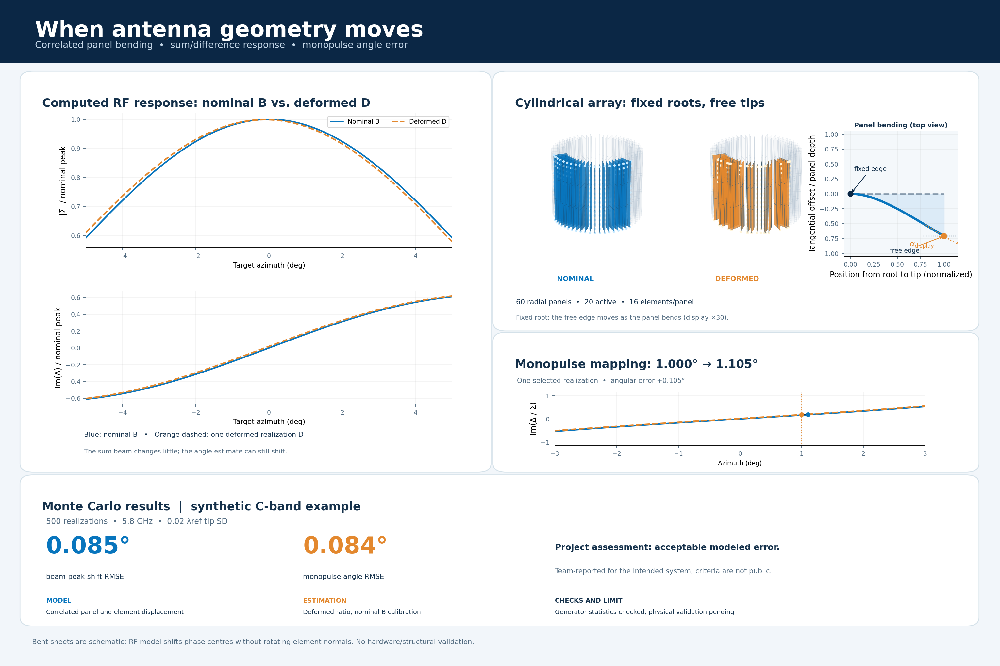

# Cylindrical array deformation and azimuth estimation

This is an **illustrative, synthetic C-band model** for a public engineering portfolio. The numerical configuration is deliberately distinct from the source engineering project. No measured array, field data, organisation, project name, or hardware specification is included. Results must be described as simulations, not measured radar performance.

The full cylinder has **60 equally spaced columns**. A centred contiguous sector of **20 columns** is active for each calculation, with **16 elements vertically per column** (320 active elements). The illustrative 5.2–5.8 GHz band sets the reference wavelength at 5.8 GHz. Both vertical pitch and circumferential chord pitch are half that wavelength; the radius follows from the 60-column geometry. The active sector is an open arc, so its two ends are not correlated as neighbours.

The phase centre moves along each panel as frequency changes. The normalized location is `xi = ((f - f_low)/(f_high - f_low))^phase_center_power`. At the low endpoint it lies at the attachment; at the high endpoint it lies near the free end. The default uniform-load displacement gain is `xi²(6 - 4xi + xi²)/3`; the optional tip-force shape is `xi²(3 - xi)/2`. These are the same parametric shapes and endpoint behaviour as the source simulation. They are not a calibrated structural prediction. The shared mechanical state is sampled from correlated panel loads and small element residuals. One tangential field generates the radial and vertical components using explicit ratios. The default tip standard deviation is **0.02 times the public reference wavelength**, and all sweep levels use that same wavelength normalization.

The receiver model has two subarray channels per row (left and right), giving 32 channels. Hamming azimuth weights and Taylor elevation weights form the sum and difference patterns. The four scenarios are A, ideal single beam; B, nominal stack with analog elevation setting; C, deformed single beam; and D, deformed stack. Monopulse calibration uses the monotone branch of `imag(Delta/Sigma)` from nominal B. The beam reference is B's nominal peak. Invalid extrapolation is reported as NaN and counted separately; RMSE excludes invalid estimates. No receiver noise, multipath, mutual coupling, random RF phase/gain error, or measured element pattern is simulated.

## Run

Python 3.10+ with NumPy, SciPy, and Matplotlib:

```bash
python -m pip install -r python/requirements.txt
python python/array_study.py --mode baseline --trials 500
python python/array_study.py --mode baseline --trials 500 --validate-generator
python python/array_study.py --mode frequency --trials 500
python python/array_study.py --mode sensitivity --trials 500
python python/array_study.py --mode study --trials 500
```

`--mode all` runs every analysis and can take a long time. Results and PNG figures appear in `output_python/`. Generator validation uses 10,000 realizations unless omitted. Each Monte Carlo realization samples a new mechanical field. Sweeps reuse the seed at each point to allow paired comparison. The Python and MATLAB random generators differ, so their individual realizations and summary numbers are not expected to be bit-for-bit identical.

In MATLAB R2018b or newer, add `matlab/` to the path, then:

```matlab
c = ArrayStudyConfig();
RunArrayStudy('baseline', c);
RunArrayStudy('sensitivity', c);
RunArrayStudy('study', c);
RunArrayStudy('all', c);
```

The MATLAB `baseline` mode also runs the frequency study when `c.run_frequency` is true; Python exposes that study as its own mode. MATLAB additionally writes `.mat` and `.fig` files and stores the full point data during studies. Python writes CSV summaries and PNG figures. Figure names and plotting detail differ, while the geometry, mechanical field, four scenarios, calibration rule, and error definitions follow the same model. The MATLAB rewrite has not been executed in a MATLAB runtime here; Python was run with a small smoke sample and its 10,000-realization generator check passed.

## Portfolio figure



The [Python figure generator](figures/make_linkedin_figure_v2.py) combines a schematic view of rectangular panels fixed to the cylinder at one edge with **computed** sum and difference cuts, the monopulse ratio, and an example angle estimate. The mechanical displacement in the 3D view is enlarged 30× for visibility; the plotted RF responses use the physical model displacement. The figure uses the committed [scenario summary](figures/scenario_summary.csv) and recomputes the illustrated response from the Python model:

```bash
python figures/make_linkedin_figure_v2.py --summary figures/scenario_summary.csv
```

For the illustrated 5.8 GHz, 500-realization case, the simulated beam-peak shift RMSE is **0.085°**, and the monopulse angle-error RMSE is **0.084°**. These are model outputs, not hardware measurements or structural validation. The intended-system assessment described alongside this portfolio example is a team-reported conclusion; its acceptance criteria are not included here.

## Publication boundary

The settings are invented for demonstration, including operating band, element count, cylinder dimensions, target angles, active sector, seed and sweep levels. Do not add source project reports, original parameter tables, measured plots, company identifiers, equipment identifiers, internal requirements, or comments about the original values to this repository. When publishing or reusing the repository, review its history as well as its current files; deleting a file does not remove it from commit history.
